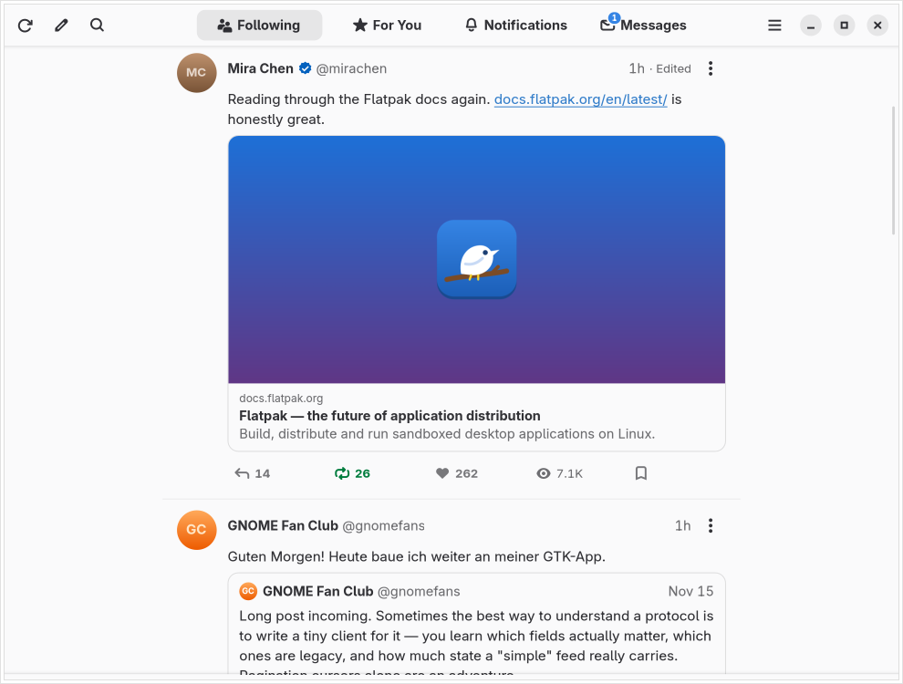
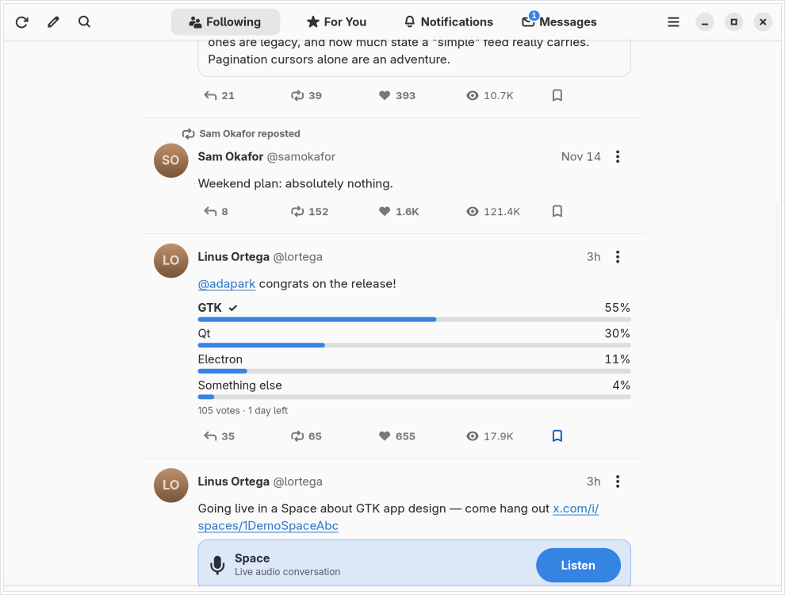
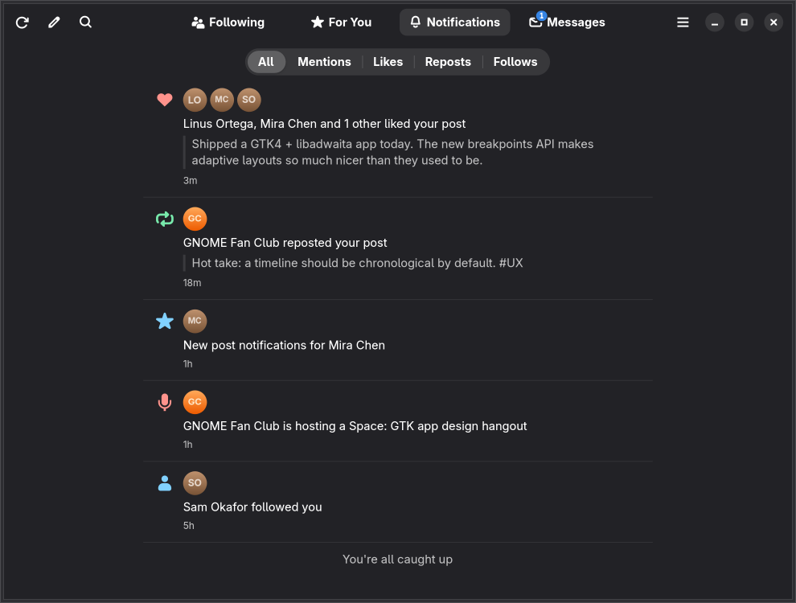
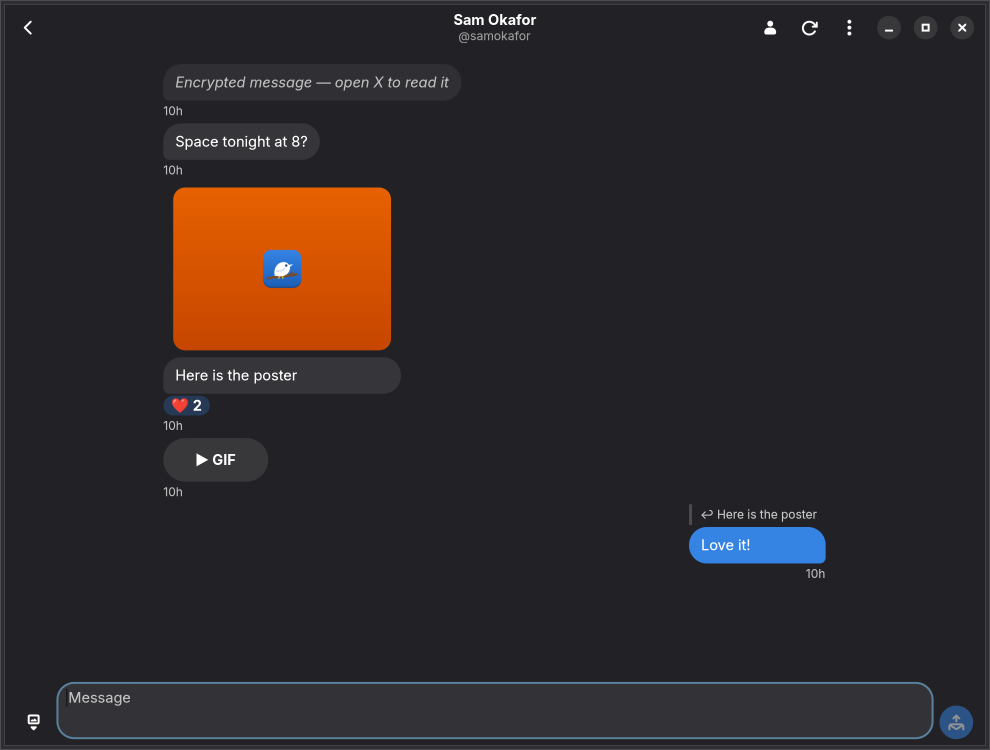

<div align="center">


# Perch

**A native GNOME client for X.**
Timelines, notifications, direct messages and Spaces — in a fast, keyboard-friendly GTK 4 / libadwaita app.

[](https://github.com/eboye/perch/releases/latest)
[](https://github.com/eboye/perch/actions/workflows/flatpak-release.yml)

[](LICENSE)



</div>

> [!IMPORTANT]
> Perch is an independent project, not affiliated with or endorsed by X Corp. It talks to X through
> [rettiwt-api](https://github.com/Rishikant181/Rettiwt-API), an unofficial library that uses your web
> session. Using it may be against X's terms of service, and your account can be rate limited or
> locked. Use it at your own risk.

## Features

**Reading**
- Following and For You timelines, with a “new posts” pill that adds new posts in place
- Post pages with the reply chain, replies, edit history, quotes, and who liked or reposted
- Polls with live results and voting; link previews; Spaces cards
- Photo, video and GIF viewer with zoom and swipeable galleries
- Profiles with posts, replies, media, likes and highlights; followers and following lists
- Search for posts and people, with filters (from, minimum likes, dates, language, no replies) and saved searches
- Bookmarks, lists (pinnable as tabs), translation of posts in other languages
- Ads are clearly marked — or hidden altogether with **Preferences → Hide ads**

**Writing**
- Posts, replies, quotes and threads, with drafts kept per post
- Up to four images (with descriptions), or a GIF, or a video with upload progress
- Polls with 2–4 choices and a duration from 5 minutes to 7 days
- Scheduled posts, and deleting your own
- Spell checking in every text box, with suggestions on right-click and a remembered language

**Messages and notifications**
- Direct messages with photos, GIFs, replies, reactions, an unread filter and earlier history
- Notifications grouped per post, with an excerpt, filterable by mentions, likes, reposts and follows
- Desktop notifications for the kinds you choose, and an unread count on the dock icon

**Spaces**
- Listen to live Spaces and replays without leaving the app

**Desktop integration**
- Adaptive layout from phone to desktop width; follows the system light/dark style live
- Keeps running in the dock when closed, and remembers its size, tab and your place in the timeline
- Opens X links in the app: <kbd>Ctrl</kbd>+<kbd>L</kbd>, `perch <link>`, or `twitter://` links
- Several accounts, muted words, muted and blocked accounts
- Screen reader labels and keyboard navigation throughout

**Reliability**
- Opens instantly on your saved timelines, and keeps showing them when X can't be reached
- Backs off automatically while X rate limits, and serves recent copies in the meantime
- Optional crash reports you can review and send yourself

<table>
  <tr>
    <td width="50%"></td>
    <td width="50%"></td>
  </tr>
  <tr>
    <td align="center">Polls</td>
    <td align="center">Notifications</td>
  </tr>
  <tr>
    <td colspan="2" align="center"></td>
  </tr>
  <tr>
    <td colspan="2" align="center">Direct messages</td>
  </tr>
</table>

## Installation

Perch is distributed as a Flatpak bundle. Download `Perch.flatpak` from the
[latest release](https://github.com/eboye/perch/releases/latest), then:

```sh
flatpak install --user Perch.flatpak
flatpak run io.github.eboye.Perch
```

The GNOME 51 runtime is installed from Flathub if it isn't already present. A running Perch notices
when a newer version is installed and offers to restart into it.

### Building from source

```sh
git clone https://github.com/eboye/perch.git
cd perch
build-aux/build-flatpak.sh --install
```

This needs `flatpak-builder` and network access during the build (the bridge's npm dependencies).

## Signing in

Perch signs in with a rettiwt **API key**: an encoded copy of your x.com session cookies.

1. Install the X Auth Helper browser extension described in rettiwt-api's
   [authentication guide](https://github.com/Rishikant181/Rettiwt-API#authentication).
2. Log in to x.com — ideally in a private window that you then close without logging out, so the
   session stays valid.
3. Generate the key and paste it into Perch.

The key is stored in your keyring (the Secret portal inside Flatpak), one entry per account.
**Treat it like a password:** it gives full access to the account. Use **Main menu → Add Account…**
to add more accounts and **Sign Out** to remove one.

## Keyboard shortcuts

| Action | Shortcut |
| --- | --- |
| New post | <kbd>Ctrl</kbd>+<kbd>N</kbd> |
| Send post (in the compose box) | <kbd>Ctrl</kbd>+<kbd>Enter</kbd> |
| Search | <kbd>Ctrl</kbd>+<kbd>F</kbd> |
| Open an X link | <kbd>Ctrl</kbd>+<kbd>L</kbd> |
| Refresh | <kbd>Ctrl</kbd>+<kbd>R</kbd> |
| Next / previous post | <kbd>J</kbd> / <kbd>K</kbd> |
| Open the selected post | <kbd>Enter</kbd> |
| Like / reply to the selected post | <kbd>L</kbd> / <kbd>R</kbd> |
| Go back | <kbd>Esc</kbd> or <kbd>Alt</kbd>+<kbd>←</kbd> |
| Preferences | <kbd>Ctrl</kbd>+<kbd>,</kbd> |
| All shortcuts | <kbd>Ctrl</kbd>+<kbd>?</kbd> |
| Close to the dock / quit | <kbd>Ctrl</kbd>+<kbd>W</kbd> / <kbd>Ctrl</kbd>+<kbd>Q</kbd> |

## Privacy and data

Perch talks only to X and its media servers. It has no analytics or telemetry; the only other site it
opens is GitHub, and only when you choose to report a crash.

| What | Where | Notes |
| --- | --- | --- |
| API keys | Your keyring | One entry per account; removed on Sign Out |
| Settings, drafts, saved searches | `~/.var/app/io.github.eboye.Perch/config/perch` | |
| Recent answers from X | Memory only | About a minute for timelines, 15 s for messages and notifications |
| Saved timelines | `…/cache/perch/snapshots/<account>` | The last ~150 posts of Following and For You, and your place in them |
| Images | `…/cache/perch/images` | Trimmed to 300 MB by default (adjustable in Preferences) |
| Crash reports | `…/cache/perch/crash` | Kinds of steps only — never posts, names, messages or links |

Link previews come from X's own data for the post; Perch never fetches the linked page itself.
Perch doesn't report ad views or clicks back to X.
Crash reports are shown to you on the next start and are only sent if you copy them or open the
prefilled GitHub issue yourself. **Preferences → Cache** clears saved data at any time.

## How it works

```
GTK 4 + libadwaita UI (Python)  ⇄  JSON lines over stdio  ⇄  Node.js bridge (rettiwt-api, bundled with esbuild)
```

- **`perch/`** — the application: windows, pages, timelines, the compose box and the bridge client.
- **`sidecar/`** — the bridge to X: a JSON-RPC server around rettiwt-api, with a response cache,
  chunked media uploads, polls, link previews, direct messages and Spaces, plus offline demo data.
- **`io.github.eboye.Perch.yml`** — the Flatpak manifest (GNOME 51 runtime, Node.js 24, libspelling).

Spaces audio plays through GStreamer. Spell checking uses libspelling with the dictionaries that ship
with the GNOME runtime.

## Development

Running from source needs Python 3 with PyGObject, GTK 4, libadwaita, GStreamer (for Spaces and
videos) and Node.js; libspelling is optional (spell checking).

```sh
npm --prefix sidecar ci && npm --prefix sidecar run build   # build the bridge
PERCH_DEMO=1 python3 -m perch                               # run with offline demo data, no account
npm --prefix sidecar test                                   # bridge unit tests
```

Useful environment variables:

| Variable | Effect |
| --- | --- |
| `PERCH_DEMO=1` | Use built-in demo accounts and posts instead of X |
| `PERCH_API_KEY=…` | Sign in with this key instead of the keyring |
| `PERCH_KEYRING=memory` | Keep keys in memory only (with demo mode: keys `demo-1`, `demo-2`) |
| `PERCH_DEBUG_RPC=1` | Log bridge calls (method and ids only) to stderr |
| `PERCH_AUDIO_SINK="fakesink sync=true"` | Play Spaces silently |

Bugs and ideas go to the [issue tracker](https://github.com/eboye/perch/issues).

## Known limitations

- **Encrypted messages** (X Chat) appear as a placeholder; decrypting them isn't supported.
- **Links from other apps** — Linux can't hand ordinary `https://x.com` links to a specific app, so
  links clicked elsewhere open in the browser. Use <kbd>Ctrl</kbd>+<kbd>L</kbd> or `perch <link>`.
- **Flathub** — the build downloads npm dependencies, so publishing on Flathub would first need
  offline sources generated with `flatpak-node-generator`.
- **Video length** — X accepts videos up to 2 minutes 20 seconds without X Premium; Perch warns
  before posting a longer one.

## License

Perch is released under the [MIT License](LICENSE). It builds on
[rettiwt-api](https://github.com/Rishikant181/Rettiwt-API) and the GNOME platform.
